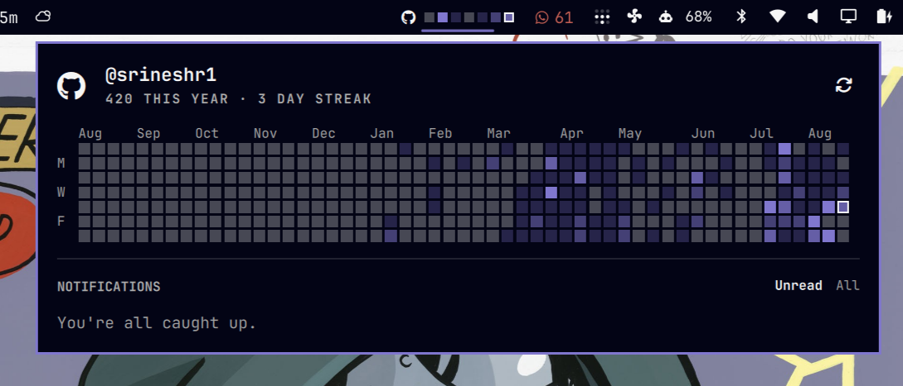

# GitHub Stats for Omarchy

Contribution boxes and GitHub inbox notifications in the Omarchy Quattro bar.

The bar shows the GitHub icon, the last seven days of contributions, and an unread badge. Click it for the year heatmap, streak, and notification list.

<p align="center">
  
</p>

## Install

Needs [Omarchy](https://omarchy.org/) 4 (Quattro) and a signed-in [GitHub CLI](https://cli.github.com/). The plugin talks to GitHub only through `gh`. It does not store tokens and does not overwrite your shell config unless you enable it.

```sh
gh auth login
omarchy plugin add https://github.com/srineshr1/omarchy-ghstats.git --enable
```

If the heatmap loads but the inbox does not:

```sh
gh auth refresh -s notifications
```

## Usage

| Action | How |
|---|---|
| Open the panel | Left click the bar icon |
| Refresh | Middle click, or `R` in the panel |
| Open github.com/notifications | Right click the bar icon, or `O` in the panel |
| Open a thread | Click it, or Enter on the highlighted row |
| Done (dismiss) | The check on a row, `E`, or `X` |
| Unread / all | `U` / `A` |
| Close | Escape |

CI / GitHub Actions noise is hidden by default. Turn that off in the widget settings (`excludeCi`).

## Configure

```sh
omarchy bar move io.github.ricky.ghstats --section right
```

| Key | Default | Meaning |
|---|---|---|
| `refreshIntervalSec` | `120` | How often to poll GitHub |
| `showHeatmap` | `true` | Last-seven-day boxes on the bar |
| `showUnreadCount` | `true` | Badge next to the icon |
| `hideWhenEmpty` | `false` | Hide the widget when nothing is unread |
| `excludeCi` | `true` | Drop `ci_activity` / CheckSuite items |
| `username` | _(signed-in account)_ | Public calendar for someone else; inbox stays yours |

## Remove

```sh
omarchy plugin remove io.github.ricky.ghstats
```

## License

MIT. See [LICENSE](LICENSE).

External dependency: [GitHub CLI](https://cli.github.com/) (`gh`), already on Omarchy and signed in with your GitHub account.
